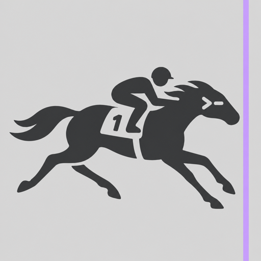
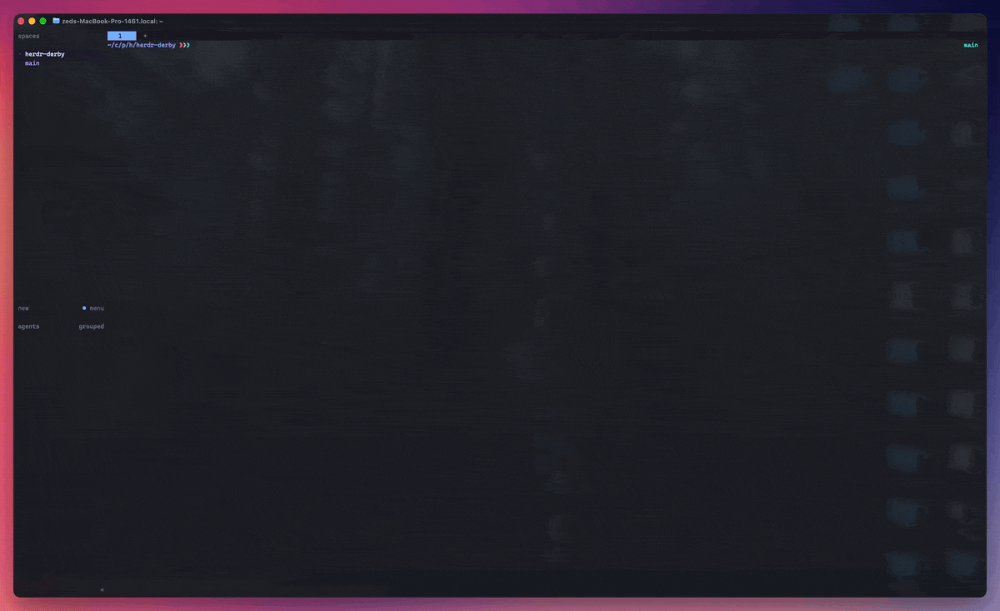
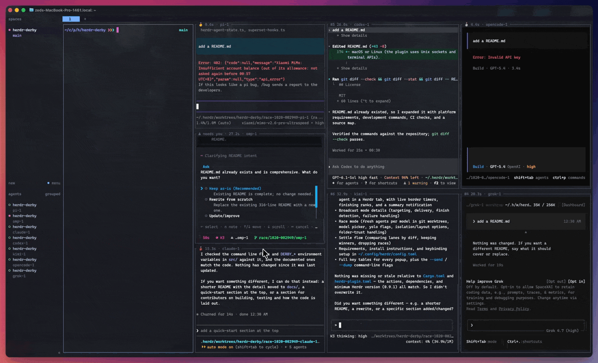

<p align="center"></p>

# herdr-derby

[English](README.md) | 简体中文

一个 [Herdr](https://herdr.dev) 插件，把内部赛马那一套搬进终端：同一个需求派给几个 coding agent，各做各的，按结果说话，留下最好的。好在这里的选手不用写周报，被优化了也没怨言。

- **广播（broadcast）**：一条 prompt 同时发给当前 tab 里的所有 agent，同一时刻起跑，主打一个公平。pane 边框上实时计时（`🏇 12.4s · claude`），跑完显示名次（`🥇 2.9s · codex`）。
- **赛马（race）**：现拉几个新的 agent 组队，种类、模型随便搭，每个一个独立的 git worktree，互不干扰。做完对比产出，留下最好的，其余的优化掉。

全程在 Herdr 里完成，一个弹窗加几个 pane 边框，`herdr --remote` 和 SSH 下也能用。

## 广播

```
 Derby  broadcast to 4 of 4 agents in this tab
──────────────────────────────────────────────
 › Compare the two caching strategies in src/cache
   and recommend one.
──────────────────────────────────────────────
 [x] 1  kimi      idle
 [x] 2  omp       idle
 [x] 3  codex     idle
 [x] 4  claude    idle
──────────────────────────────────────────────
 enter send · alt+enter newline · tab targets · esc cancel
```

- **默认发给谁**：空闲和已完成的 agent 默认勾选。正在干活的默认不勾，免得半路插话。正在等你审批或回答问题的 agent 选不了。
- **怎么发**：走 Herdr 自己的 `agent.prompt`，多行和中文都作为一条消息送到。
- **怎么判完成**：读 Herdr 原生的 agent 状态，不需要 agent 配合，没有标记文件，也不套脚本。
- **等你不计时**：agent 停下来等审批或问你问题时，边框显示 `⚠ needs you`。等你拍板的这段不算它的工时，单独标出来：`🥈 3m32s (+1m10s waiting)`。
- **两种失败分开记**：`✗ not sent` 是压根没收到，`✗ failed` 是收到了但翻车了。同一条 prompt 绝不会送到两遍。

## 赛马



```
 Derby  race 3 fresh agents · worktree per agent · split this tab
──────────────────────────────────────────────
 › Make the importer stream instead of
   loading the whole file.
──────────────────────────────────────────────
   pi         default                        ·
 ▾ claude                                    ×2  yolo
     opus                                    ×1  yolo
     sonnet                                  ×1  yolo
   codex      default                        ×1
 ▸ kimi       k3, kimi-for-coding            ·
 isolation    ‹ worktree per agent ›
 layout       ‹ split this tab ›
──────────────────────────────────────────────
 ←→ close/open · m models · y yolo · 0 none · ^a all · ^l none
```

- **Agent**：已安装 Herdr integration、并且在 PATH 上的 agent。
- **模型**（`m`）：打字筛选，可以一次勾多个。每个模型单独一行，各自设数量和 yolo。
  - 模型列表来自各家 CLI（`codex debug models`、`kimi provider list`、`omp models`、`pi --list-models`，claude 用别名），每次打开都重新读取并缓存。
  - 列表里没有的名字也能直接填。
  - `default` 表示不传 `--model`。
- **yolo**（`y`）：跳过审批，先斩后奏。实际传的参数：
  - claude：`--dangerously-skip-permissions`
  - codex、gemini、qwen：`--yolo`
  - kimi：`--auto`
  - omp：`--auto-approve`
  - copilot：`--allow-all-tools`
- **隔离**（isolation）：
  - 每个 agent 一个 worktree：从 HEAD 拉出分支 `race/<id>/<agent>`，放在 `~/.herdr/worktrees/<repo>/`。
  - 所有 agent 共用当前目录。不在 git 仓库里时只能这样。
- **布局**（layout）：分割当前 tab、每个 agent 一个 tab，或每个 agent 一个 workspace。

所有 agent 都真正就绪后才会发 prompt，每个最多等 60 秒。启动期间：
- agent 卡在信任文件夹的对话框上（kimi 每到一个新 worktree 都要问一句"你信我吗"）时，`y` 替它信任，`n` 把它去掉。
- `x` 单独去掉一个。
- Esc 全部取消，已经建好的都删掉。

上次的配置会记住，下次一键复刻。

### 收尾（settle）

先交付不等于做得好。settle 把每个 lane 的实际产出摆出来，赛后复盘，用结果说话：

```
 Derby  settle race 1019-143205 · 3 lanes · base a1b2c3d
──────────────────────────────────────────────────────────────────
     lane         finish           changes              branch
 [ ] claude-1     🥈 4m12s         5 files +120 −34     race/1019-143205/claude-1
 [•] codex-1      🥇 2m55s         2 files +18 −2       race/1019-143205/codex-1
 [ ] claude-2     ⚠ needs you      no changes           race/1019-143205/claude-2
──────────────────────────────────────────────────────────────────
 ↑↓ move · space pick winners · d diff · f go to pane · enter review · D drop race · esc
```

1. 空格选赢家，可以选多个。`d` 看 diff，`f` 跳到它的 pane 看它说了什么。
2. 回车预览要删除的东西，没提交的改动会特别标出来。
3. 按 `y` 确认：落选 lane 的 pane、worktree 和分支一起优化掉，赢家原样保留。

合并不归 Derby 管，资源整合这一步交给你。`D` 是整场放弃：项目砍掉，全员解散，就当无事发生。



没收尾的比赛会一直留着，等你回来处理。同时有好几场没收尾时，settle 先列出来让你挑。你手动删过的 lane 也认：worktree 删了但分支还在的照样能赢，什么都不剩的直接跳过。

## 环境要求

- Herdr 0.9.1+，装好要用的 agent integration（`herdr integration install <agent>`）
- Rust（`cargo`）：安装时从源码编译
- worktree 需要 `git`

## 安装

```bash
herdr plugin install xzedx/herdr-derby
# 或者用本地代码：
cargo build --release && herdr plugin link "$PWD"
```

Herdr 插件不能自带快捷键，需要自己在 `~/.config/herdr/config.toml` 里绑定：

```toml
[[keys.command]]
key = "prefix+ctrl+b"
type = "plugin_action"
command = "xzedx.derby.broadcast"
description = "derby: broadcast prompt to this tab's agents"

[[keys.command]]
key = "prefix+ctrl+r"
type = "plugin_action"
command = "xzedx.derby.race"
description = "derby: race fresh agents"

[[keys.command]]
key = "prefix+ctrl+s"
type = "plugin_action"
command = "xzedx.derby.settle"
description = "derby: settle or drop races"
```

## 按键

Ctrl+N / Ctrl+P 在任何地方都等于 ↓ / ↑。

输入框：

| 按键 | 作用 |
| --- | --- |
| Enter | 发送 / 开始 |
| Alt+Enter、Ctrl+J | 换行 |
| 输入框为空时按 ↑ | 上一条 prompt |
| Ctrl+U | 清空 |
| Tab | 切到下面的列表 |
| Esc、Ctrl+C | 取消 |

广播的目标列表：

| 按键 | 作用 |
| --- | --- |
| Space、x / 1-9 | 勾选 / 取消 |
| a | 全部勾选 / 全部取消 |
| Ctrl+A / Ctrl+L | 全选 / 全不选 |

赛马的 agent 列表：

| 按键 | 作用 |
| --- | --- |
| → + / ← - | 加一个 / 减一个；切换隔离或布局 |
| 在有多个模型的 agent 上按 → / ← | 展开 / 收起 |
| 0 | 清零 |
| y | yolo 开 / 关 |
| m | 选模型 |
| d | 删掉这个模型 |
| Ctrl+A / Ctrl+L | 每个各一个 / 全部清零 |

模型选择：

| 按键 | 作用 |
| --- | --- |
| 打字 | 筛选，或直接用输入的名字 |
| Space | 勾选 |
| Ctrl+U | 清空筛选 |
| Enter | 用勾选的（一个没勾就用高亮的那个） |
| Esc | 返回 |

启动期间：

| 按键 | 作用 |
| --- | --- |
| x | 去掉这个 agent |
| y / n | 信任 / 去掉卡在信任对话框上的 agent |
| r | 重新检查 |
| Enter | 已就绪的先开跑 |
| Esc | 全部取消并删掉 |

收尾：

| 按键 | 作用 |
| --- | --- |
| Space、x / 1-9 | 选赢家 |
| d / f | 看 diff / 跳到 pane |
| Enter | 预览要删除的 |
| D | 整场放弃 |
| y | 确认 |
| Esc、q | 返回 / 关闭 |

## 命令行

```bash
herdr-derby --send [--tab w1:t1] "prompt"   # 不开弹窗直接跑
herdr-derby --dump [--tab w1:t1]            # 打印一帧弹窗
```

`DERBY_TRACE=<file>` 记录计时；`DERBY_TEST_INPUT=<bytes>` 给弹窗喂按键，测试用。

## 许可证

MIT
